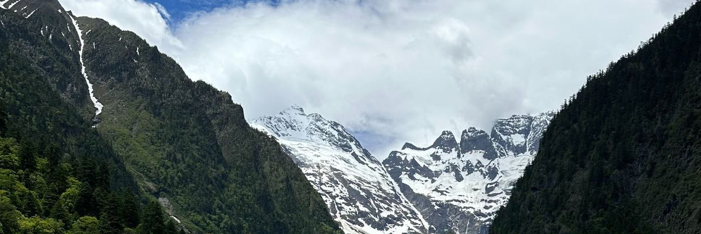

  

# Russell Wang

My work spans cloud infrastructure testing, machine learning, software engineering and applied data science.

[LinkedIn](https://www.linkedin.com/in/russellwang613) · [Email](mailto:russwang@umich.edu) · [GitHub](https://github.com/Russellwangz)

### Skills

**Programming:** Python · Java · C++ · SQL · R · SQL

**Machine Learning & Data:** Pandas · NumPy · Pytorch

**Software & Cloud:** AWS CLI · Docker · Terraform · GitHub · Flask

**Tools & Formats:** JSONL · Excel · Word · PowerPoint

**Languages:** Chinese  · English  · Japanese 
